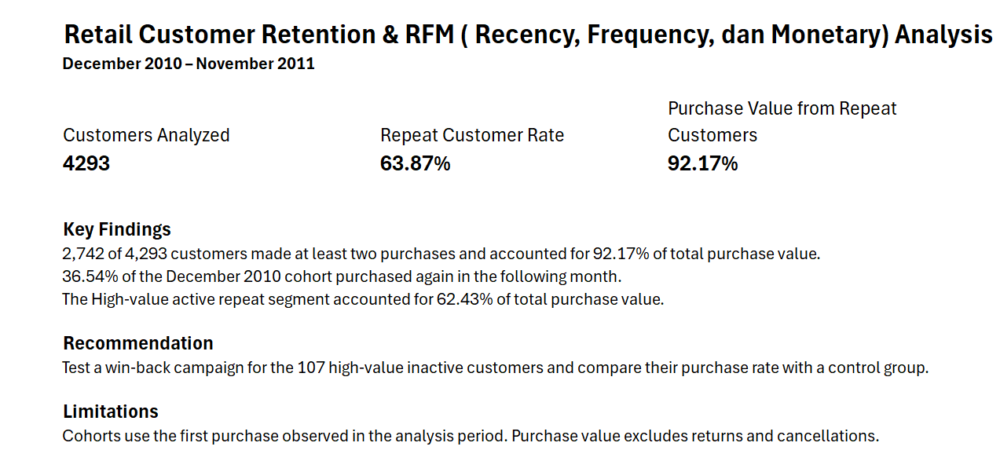
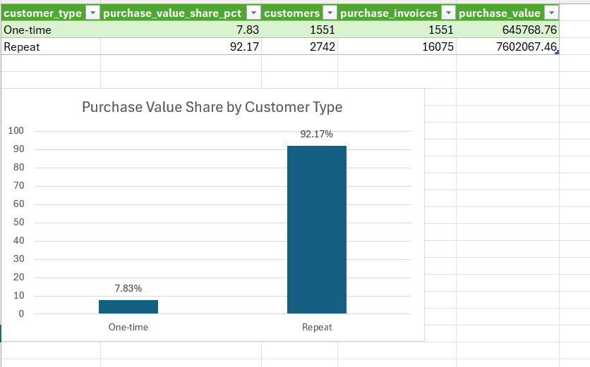
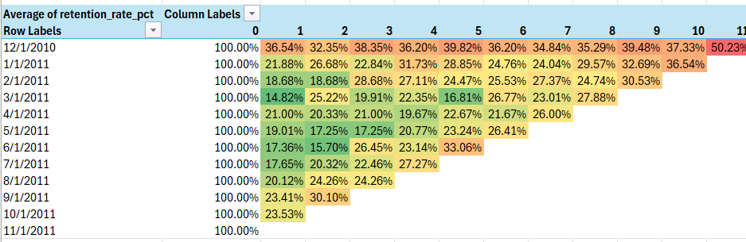
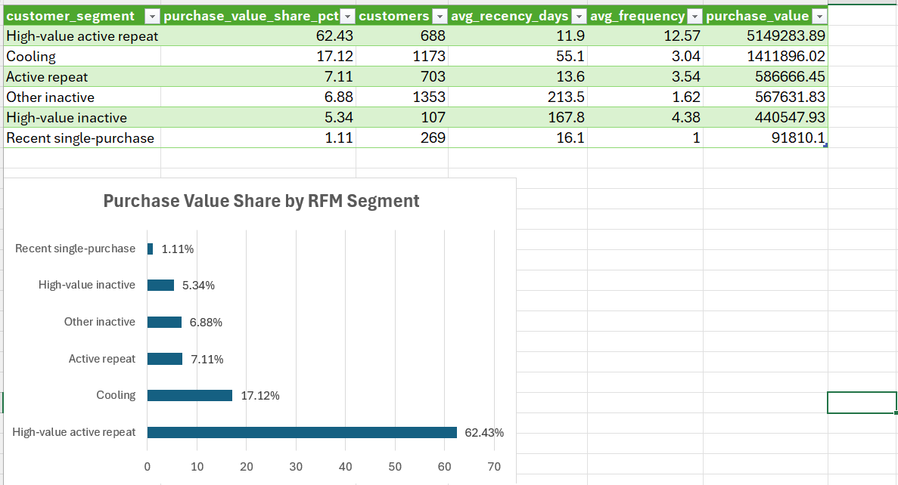

# Retail Customer Retention & RFM Analysis

**PostgreSQL · Excel · Power Query · Cohort Analysis · Customer Segmentation**

This project analyzes repeat purchases, monthly customer retention, and customer value using the Online Retail dataset. It follows six phases: **Ask, Prepare, Process, Analyze, Share, and Act**.

**Analysis period:** December 1, 2010–November 30, 2011  
**RFM reference date:** December 1, 2011

## Executive Summary

The analysis covers **4,293 customers**, **17,626 purchase invoices**, and **379,098 eligible transaction lines**, representing **£8,247,836.22** in purchase value.

- **63.87% of customers** placed at least two eligible purchase invoices during the analysis period.
- Repeat customers accounted for **92.17% of purchase value**, including the value of their first purchases.
- **36.54% of the December 2010 cohort** purchased again in January 2011.
- The **High-value active repeat** segment contributed **62.43% of purchase value**.
- **107 High-value inactive customers** were identified as candidates for a controlled win-back test.

Purchase value includes eligible positive purchase lines. It does not deduct returns or cancellations and should not be interpreted as net revenue.

## 1. Ask — Define the Business Problem

A retailer wants to know which customers return, how purchasing activity changes after a customer's first observed purchase, and which groups to prioritize for retention.

The analysis answers five questions:

1. What proportion of customers make more than one purchase?
2. How much purchase value comes from one-time and repeat customers?
3. What proportion of each monthly cohort purchases in subsequent months?
4. Which customer segments account for the largest share of purchase value?
5. Which groups are candidates for retention or reactivation campaigns?

The results are intended to support CRM, marketing, and retail management decisions about customer prioritization and campaign testing.

## 2. Prepare — Understand the Data and Tools

### Data source

The project uses the [Online Retail dataset from the UCI Machine Learning Repository](https://archive.ics.uci.edu/dataset/352/online+retail).

The raw data contains **541,909 transaction lines** with timestamps from **December 1, 2010 to December 9, 2011**. Each row represents a line on an invoice, so an invoice can appear on multiple rows.

| Field | Description |
|---|---|
| `InvoiceNo` | Invoice identifier; cancellation invoices can have a `C` prefix |
| `StockCode` | Product or transaction code |
| `Description` | Product or transaction description |
| `Quantity` | Quantity recorded on the invoice line |
| `InvoiceDate` | Invoice date and time |
| `UnitPrice` | Unit price in GBP |
| `CustomerID` | Customer identifier |
| `Country` | Customer country |

### Tools

| Tool | Role |
|---|---|
| PostgreSQL and pgAdmin | Import data, check data quality, create analytical views, calculate metrics, and validate results |
| Excel and Power Query | Inspect data quality, import SQL outputs, and correct data types |
| Excel PivotTables and charts | Build the cohort heatmap, purchase contribution charts, and executive summary |
| Git and GitHub | Track project files and publish the portfolio documentation |

## 3. Process — Check Quality and Define Eligible Purchases

### Raw-data quality checks

| Check | Rows |
|---|---:|
| Total source rows | 541,909 |
| Missing `CustomerID` | 135,080 |
| Cancellation invoices | 9,288 |
| Negative quantity | 10,624 |
| Zero quantity | 0 |
| Non-positive unit price | 2,517 |
| Missing invoice date | 0 |

These checks overlap. For example, a cancellation row can also have a negative quantity, so the counts cannot be added to calculate the total number of excluded rows.

### Eligibility rules

| Rule | Reason |
|---|---|
| Require a customer identifier | Retention and RFM metrics need purchases linked to customers |
| Exclude cancellation invoices | Focus on eligible positive purchase behavior |
| Require `Quantity > 0` and `UnitPrice > 0` | Exclude returns and lines with non-positive quantities or prices |
| Include dates from `2010-12-01` up to, but not including, `2011-12-01` | December 2011 is only partially observed; excluding it makes the analysis period consist of complete calendar months |
| Exclude `POST`, `C2`, `DOT`, `BANK CHARGES`, and `M` | Remove shipping charges, bank charges, and ambiguous manual entries from merchandise purchase value |
| Retain `PADS` when otherwise eligible | Its description alone does not justify classifying it as a non-product entry |

### Duplicate assessment

The raw data contained **4,879 groups of identical rows** and **5,268 additional duplicate rows**. A group that appears three times contributes two additional rows, which is why the second count can exceed the first.

Identical rows were retained because matching values alone do not establish that the source recorded a transaction by mistake. A preliminary comparison found that removing identical rows reduced purchase value by **£23,196.66**, about **0.28%** of purchase value in that comparison population. This check preceded the final eligibility filters.

### Analytical views

| View | Level of detail and purpose |
|---|---|
| `analytics.purchase_lines` | One row per eligible transaction line; calculates `quantity × unit_price` |
| `analytics.purchase_invoices` | One row per customer and invoice; avoids counting separate product lines as separate purchases |
| `analytics.customer_monthly_activity` | One row per active customer and month; identifies the first observed purchase month |
| `analytics.customer_rfm` | One row per customer; calculates recency, frequency, and monetary value |
| `analytics.customer_segments` | One row per customer; assigns a segment using business rules |

### Final analysis population

| Metric | Result |
|---|---:|
| Eligible transaction lines | 379,098 |
| Eligible purchase invoices | 17,626 |
| Unique customers | 4,293 |
| Purchase value at full SQL precision | £8,247,836.223 |
| Purchase value rounded for reporting | £8,247,836.22 |

## 4. Analyze — Answer the Business Questions

### A. Repeat purchase analysis

A **one-time customer** has one eligible purchase invoice during the analysis period. A **repeat customer** has at least two.

**Repeat customer rate = repeat customers ÷ all eligible customers × 100**

| Customer type | Customers | Purchase invoices | Purchase value | Share of purchase value |
|---|---:|---:|---:|---:|
| One-time | 1,551 | 1,551 | £645,768.76 | 7.83% |
| Repeat | 2,742 | 16,075 | £7,602,067.46 | 92.17% |

**2,742 of 4,293 customers made repeat purchases (63.87%).** They accounted for **92.17% of observed purchase value**. This includes their first purchase and does not measure the effect of a retention campaign.

### B. Cohort retention analysis

A cohort groups customers by their **first observed eligible purchase month**. Monthly retention measures the proportion of that original cohort that made at least one eligible purchase in a specific month.

**Retention at month k = cohort customers active in month k ÷ original cohort size × 100**

| Month index | Interpretation |
|---|---|
| `0` | First observed purchase month; retention is 100% by definition |
| `1` | One calendar month after the cohort month |
| `2` | Two calendar months after the cohort month |
| `11` | Eleven calendar months after the cohort month |

For the **December 2010 cohort**, **323 of 884 customers** purchased again in January 2011, giving **36.54% month-1 retention**. In November 2011, **444 of those 884 customers** purchased, giving **50.23% month-11 retention**.

Retention can rise from one month to another because a customer can skip a month and return later. Blank cells beyond the observation window indicate months that could not be measured. Compare cohorts at the same month index and consider that the corresponding calendar months may differ.

### C. RFM analysis and segmentation

RFM stands for **Recency, Frequency, and Monetary value**.

| Dimension | Calculation | Interpretation |
|---|---|---|
| Recency | Days from the customer's last eligible purchase to December 1, 2011 | Fewer days means a more recent purchase |
| Frequency | Number of eligible purchase invoices during the analysis period | More invoices means more observed purchases |
| Monetary | Sum of eligible purchase value during the analysis period | Higher value means more observed spend before deducting returns |

The project assigns segments using business rules. The rules use **30 days or fewer** for recent activity, **more than 90 days** for inactivity, **at least two invoices** for repeat purchasing, and the **75th percentile of monetary value** as the high-value threshold. The SQL `CASE` expression defines the exact conditions and their order.

| RFM segment | Customers | Share of purchase value |
|---|---:|---:|
| High-value active repeat | 688 | 62.43% |
| Cooling | 1,173 | 17.12% |
| Active repeat | 703 | 7.11% |
| Other inactive | 1,353 | 6.88% |
| High-value inactive | 107 | 5.34% |
| Recent single-purchase | 269 | 1.11% |

The **688 High-value active repeat customers** contributed **62.43%** of purchase value. The **107 High-value inactive customers** are a smaller group with a history of substantial spending, making them candidates for a win-back test.

### D. Validation

The customer-level output reconciles to **4,293 customers**, **17,626 purchase invoices**, and **£8,247,836.223** in purchase value. The repeat-purchase groups and RFM segments each sum to the same customer population. Percentages and monetary amounts are rounded for presentation, so displayed subtotals can differ slightly from totals calculated before rounding.

## 5. Share — Present the Findings

### Executive summary

The summary brings together the customer count, repeat customer rate, repeat purchase value share, and proposed next action.

### Repeat purchase contribution

The chart compares each group's share of **purchase value**. The 92.17% figure represents the value contribution of repeat customers; their share of customers is 63.87%.

### Cohort retention heatmap

Each row represents a first observed purchase cohort. Each column shows how many calendar months have passed since the cohort month. The percentages show the share of the original cohort that purchased in that month.

### RFM segment contribution

The chart shows where observed purchase value is concentrated. A segment's contribution does not establish its profitability or its likely response to a campaign.

## 6. Act — Recommend and Evaluate Next Steps

| Audience | Proposed action | How to evaluate it |
|---|---|---|
| High-value inactive | Test a win-back message or offer with the 107 identified customers | Compare purchase rate and purchase value per assigned customer against a randomized control group |
| High-value active repeat | Test a relevant loyalty benefit | Measure incremental purchases and margin after the cost of the benefit |
| Recent single-purchase | Send a follow-up encouraging a second purchase | Compare second-purchase conversion over the same follow-up window |
| Cooling | Test a re-engagement message based on prior purchase activity | Compare reactivation and incremental purchase value against a control group |

**Recommended first step:** Validate the high-value inactive audience, including whether unusually large purchases were later returned. Define the campaign's evaluation window and success metric before assigning customers to groups. With only 107 customers in the segment, report uncertainty when interpreting any measured difference.

These are proposed experiments. No campaign was run as part of this project.

## Limitations

- **First observed purchase may not be the first-ever purchase.** Customers who purchased before the dataset starts may appear in the earliest cohort.
- **Customers have unequal follow-up time.** Earlier customers have more opportunities to purchase again, so the overall repeat rate is not a fixed-window conversion rate.
- **Purchase value is not net revenue.** A large purchase later returned may still increase a customer's monetary value and affect segment assignment.
- **Missing customer identifiers limit coverage.** Anonymous purchases cannot contribute to customer-level retention or RFM.
- **Identical rows are retained.** The data does not establish whether every identical row is a genuine purchase line or a recording duplicate.
- **RFM is a historical snapshot.** The segments describe customer activity as of December 1, 2011. Different thresholds may produce different segment sizes.
- **Cohort patterns are descriptive.** Seasonality and differences in customer mix can affect retention, and the analysis does not establish causes.
- **Margin and campaign costs are not included.** A high purchase value does not necessarily mean high profitability.

## Project Files

| File or location | Purpose |
|---|---|
| `README.md` | Business questions, methodology, results, and reproduction guide |
| `excel/retail_customer_retention_rfm.xlsx` | Power Query outputs, PivotTable heatmap, charts, and executive summary |
| SQL scripts `01`–`02` | Database setup and source-data quality checks |
| `03_analysis_views.sql` | Purchase, invoice, monthly activity, RFM, and segment views |
| `04_repeat_purchase_analysis.sql` | Repeat customer rate and purchase value contribution |
| `05_cohort_retention_analysis.sql` | Monthly retention by first observed purchase cohort |
| `06_rfm_analysis.sql` | Customer-level RFM preview, segment summary, and validation |
| `images/` | Screenshots of the summary, repeat purchase chart, cohort heatmap, and RFM chart |

## How to Reproduce

1. Download the source workbook from the UCI dataset page. Keep it separate from the analytical Excel workbook.
2. Create the PostgreSQL database `retail_analytics`. Run the setup script to create the required schemas and `raw.retail_lines`.
3. Export the source worksheet to CSV and import it into the raw table with the header and column order matching the table. Confirm date and decimal parsing. The project CSV uses month/day/year dates. If you change PostgreSQL's database-level `DateStyle`, reconnect before importing.
4. Run the data-quality checks and verify **541,909 raw rows** and the expected source date range.
5. Run `03_analysis_views.sql`, then run the repeat purchase, cohort retention, and RFM scripts in order.
6. Reconcile the outputs against the customer, invoice, and purchase-value totals in this README.
7. Export the SQL results to CSV and import them into Excel through Power Query. If the CSV uses a decimal point, use a matching locale such as English (United States). Correct the original type conversion if `36.54` was imported as `3654`; changing the resulting whole number to a decimal type will not restore the separator.
8. Keep customer identifiers as text, counts as whole numbers, and purchase values as decimals. Build the cohort PivotTable with cohort month as rows, month index as columns, and retention as values.
9. Format percentage values consistently. SQL outputs such as `36.54` are already on a 0–100 scale. To use Excel's standard Percentage format, divide by 100 first; alternatively, use a custom format that appends a literal `%`.
10. Review the four visuals and save the report workbook. If you move the workbook to another machine, update the Power Query source paths before refreshing.

### Excel workbook notes

- `Raw_Transactions` can remain **connection only**.
- `Quality_Summary` shows the initial data-quality checks.
- `Cohort_Retention` contains the query output used to build the heatmap.
- `repeat_purchase_summary` contains the two customer-type rows.
- `rfm_segment_summary` contains the six RFM segment rows.
- The charts can sit beside their source tables. Separate `Repeat_Purchase` and `RFM_Segments` sheets are optional.

## Skills Demonstrated

Business question formulation, SQL views and aggregation, data-quality checks, reconciliation, cohort analysis, RFM segmentation, Power Query, Excel visualization, and communication of business recommendations.